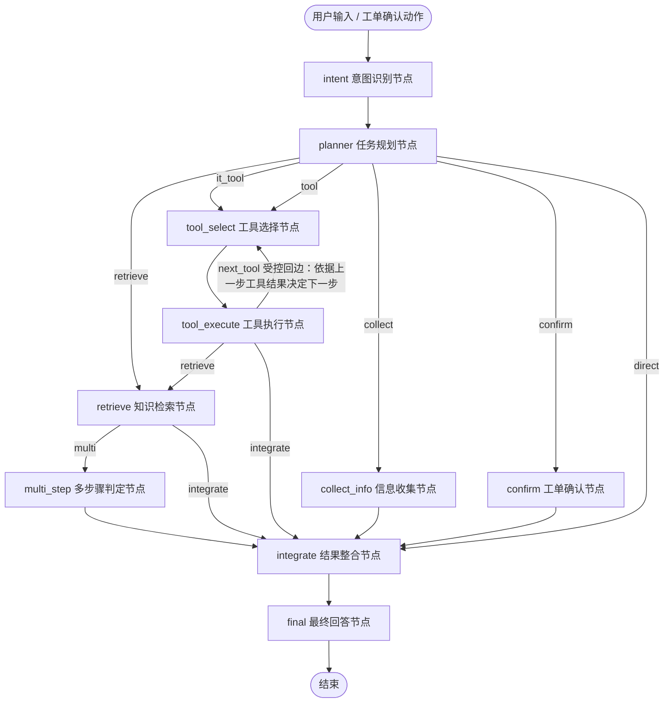
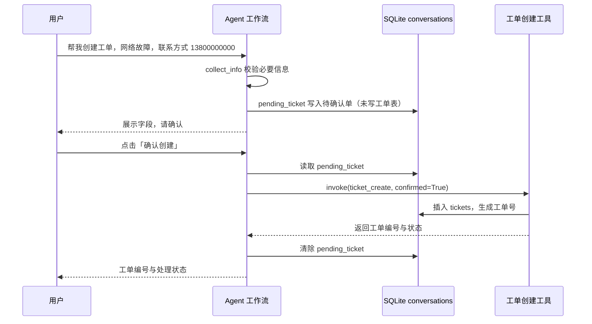

# Agent 工作流

> 条件边标签使用 `backend/agent/planner.py` 的 **route 名**（`retrieve / it_tool / tool / collect / confirm / direct / multi / integrate / next_tool`），不是意图名。图与 `backend/agent/graph.py`、`planner.py`、`nodes.py` 一致。

## 一、LangGraph 状态图（与 `agent/graph.py` 一致）

- 简单知识查询只经过 `intent → planner → retrieve → integrate → final`，不强制走全部节点。
- IT 咨询（`it_consult`）先调用 `it_service_query` 工具查服务目录，再检索知识库，最后整合两类结果。
- 多步骤任务（`multi_step`）在检索后进入 `multi_step` 判定节点，给出「无解时如何创建工单」的建议，但**不会擅自创建工单**。
- **`tool_execute → tool_select` 是受控回边**（`graph.py` 的 `add_conditional_edges("tool_execute", route_after_tool, ...)` 中的 `next_tool`）：是否继续第二个工具由前一步工具返回的结果内容决定，而不是只看意图固定跳转。`tool_execute_node` 每执行完一个工具把 `plan_index` 加 1，`route_after_tool` 据此判断队列中是否还有下一步。

## 二、条件边映射（route 键，不是意图名）

`graph.py` 共注册三组条件边，映射键与 `planner.py` 的返回值一一对应：

| 条件边所在节点 | 路由函数 | 映射键 | 目标节点 |
| --- | --- | --- | --- |
| `planner` | `route_by_intent` | `retrieve` | `retrieve` |
| `planner` | `route_by_intent` | `it_tool` | `tool_select` |
| `planner` | `route_by_intent` | `tool` | `tool_select` |
| `planner` | `route_by_intent` | `collect` | `collect_info` |
| `planner` | `route_by_intent` | `confirm` | `confirm` |
| `planner` | `route_by_intent` | `direct` | `integrate` |
| `tool_execute` | `route_after_tool` | `retrieve` | `retrieve` |
| `tool_execute` | `route_after_tool` | `next_tool` | `tool_select`（受控回边） |
| `tool_execute` | `route_after_tool` | `integrate` | `integrate` |
| `retrieve` | `route_after_retrieve` | `multi` | `multi_step` |
| `retrieve` | `route_after_retrieve` | `integrate` | `integrate` |

意图 → route 的映射见 `planner.py::ROUTES`：`knowledge_query / multi_step → retrieve`，`it_consult → it_tool`，`multi_tool / ticket_query → tool`，`ticket_create → collect`，`ticket_confirm → confirm`，`chitchat / unknown → direct`。`route_by_intent` 还有一条优先规则：当 `needs_clarification` 为真且 `clarifying_question` 非空时，直接返回 `collect`，把路径改到 `collect_info`。

`route_after_tool`（`planner.py`）**依据前一步工具结果决策**：

- 取 `tool_results` 最后一条，判断 `status == "成功"` 与 `result` 的 `found / items`；
- `it_consult`：服务目录查询成功才 `retrieve` 继续检索知识库，失败直接 `integrate` 输出错误说明；
- `multi_tool`：第一步查到匹配服务（`found` 且 `items` 非空）、且 `plan_index < 2` 时返回 `next_tool` 回到 `tool_select` 执行第二个工具，否则 `integrate`；
- 其余情况 `integrate`。

## 三、意图与分支

| 意图 | 判定依据 | route 键 | 执行路径 |
| --- | --- | --- | --- |
| `knowledge_query` | 制度、流程、标准类关键词 | `retrieve` | 知识检索 |
| `it_consult` | 网络、软件、账号、故障类关键词 | `it_tool` | IT 服务工具 → 依结果决定是否检索知识库 |
| `ticket_create` | 明确要求创建/提交工单 | `collect` | 信息收集 → 待确认 |
| `ticket_query` | 工单状态/进度 + 编号 | `tool` | 工单状态查询工具 |
| `multi_step` | 含「如果…不行…创建工单」等条件表述 | `retrieve` | 检索 → `multi` → 后续建议 |
| `multi_tool` | 一次请求明确要求连续执行多个不同工具（如「先查…再查…」） | `tool` | 工具队列 + 受控回边连续执行 |
| `chitchat` | 短句问候 | `direct` | 直接回答能力说明 |
| `unknown` | 未匹配 | `direct` | 返回能力边界 |
| `ticket_confirm` | 用户点击确认/取消 | `confirm` | 工单确认分支 |

意图标签共 9 个，见 `agent/intent.py::INTENT_LABELS`；`multi_tool` 为第二轮新增，且在 `_rule_decision` 中**优先判定**，避免被 `ticket_query` 分支拦截。

真实模型模式下意图由 DeepSeek 的 JSON 结构化输出判定，失败时自动回退规则决策器；Mock 模式使用规则决策器。两者都在 `decision_source` 与 trace 中标注来源，见 `agent/intent.py::classify`。

## 四、工单创建的挂起 / 恢复

- 缺少故障描述或联系方式时，Agent 主动追问，不假设身份、部门或联系方式。
- `confirmed=False` 时工具抛中文错误，数据库零写入。
- 待确认单持久化在 `conversations.pending_ticket`，刷新页面后前端通过 `/api/sessions/{id}/pending` 恢复，确认状态不会丢失。

## 五、多轮对话与上下文

- 历史消息持久化在 `messages` 表，按 `session_id` 隔离；每次请求取最近 8 条构造上下文。
- `agent/intent.py::resolve_query` 对短追问（含「那 / 呢 / 如果 / 补充」等）拼接上一轮用户问题，形成完整检索查询 `resolved_query`，实现指代识别与补充条件理解。
- **追问补答恢复**（第二轮）：工单信息不全时 `collect_info_node` 调用 `set_pending(..., "ticket_create")` 写入挂起意图；下一轮 `chat_service._base_state` 把 `pending_intent` 放入状态，`intent_node` 在检测到本轮是纯补充回答（`_is_supplement`）时恢复「工单创建」意图，并把上一轮问题与补充信息合并后继续生成待确认单，避免被判成 `unknown`。
- 「对话重置」清空该会话消息与待确认状态，但不影响其它会话。

## 六、第二轮新增能力（模型规划参与路由、状态字段、决策来源）

**模型规划输出真正改变路由**：`planner.py::plan_steps` 在真实模型模式下对复杂意图（`COMPLEX_INTENTS`：含 `multi_step / multi_tool / ticket_create / knowledge_query / it_consult`）调用 `build_plan_prompt`，模型返回的 `steps` 可覆盖规则步骤，`source` 记为「DeepSeek 结构化规划」；若模型返回 `needs_clarification = true` 且给出 `clarifying_question`，`route_by_intent` 会把路径改到 `collect_info`，`collect_info_node` 直接输出追问、不误生成工单草稿。模型规划失败则回退规则规划器并置 `fallback = True`。

**`AgentState` 新增字段**（`agent/state.py`）：

| 字段 | 用途 |
| --- | --- |
| `decision_source` | 意图决策来源：DeepSeek 结构化输出 / 规则决策器 / 模型失败回退 / 用户确认动作 |
| `plan_source` | 任务规划来源：DeepSeek 结构化规划 / 规则规划器 |
| `fallback` | 本次是否发生「模型 → 规则」回退（`chat_service._to_response` 透传到 `ChatResponse`） |
| `tool_queue` | 多工具连续执行的规划队列（状态声明；当前 `tool_select_node` 依据 `plan_index` 决定具体工具） |
| `plan_index` | 当前执行到第几个工具，由 `tool_execute_node` 每次执行后 +1，供 `route_after_tool` 判断是否继续 |
| `pending_intent` | 上一轮挂起的意图，用于追问补答恢复 |
| `resolved_query` / `needs_clarification` / `clarifying_question` | 上下文改写查询、是否需追问与追问内容 |

**区分模型决策与规则回退**：`intent_node` 与 `planner_node` 分别写入上述三个来源字段；`services/chat_service.py::_to_response` 把它们放进 `ChatResponse`；`services/agent_evaluation_service.py::evaluate_question` 用 `getattr` 读取并写入评估明细（不假设字段一定存在）。因此「这次是模型决策还是规则决策」是可观测的，不需要猜测。

**工具结果来源校验**：`agent/tool_guard.py::sanitize_tool_results` 在 `integrate_node` 整合前，只采信「已注册工具名 + 合法状态 + dict 结果 + 耗时」的条目，其余一律丢弃并在 trace 中留痕，避免模型用普通文本伪装成工具执行成功。

## 七、执行记录（trace）

每个节点把**实际发生、可验证**的动作追加到 `trace`：识别的任务类型、当前阶段、选择的工具、参数摘要、执行结果、RAG 检索状态、耗时、决策来源（`decision_source`）。记录随消息一起持久化，前端可展开查看。不展示模型内部思维链。
