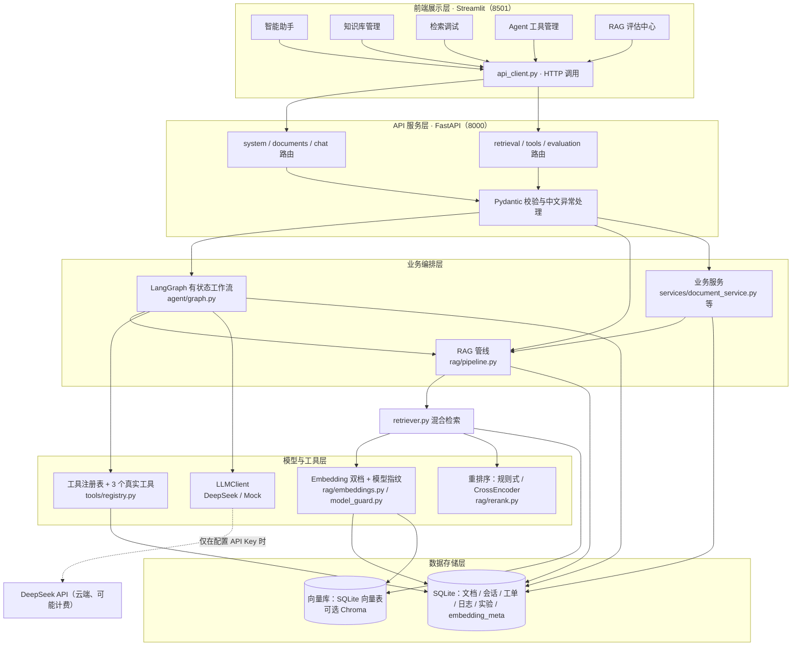
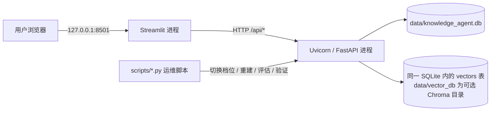

# 系统总体架构

> 本文件与代码同版本维护。图中每个组件都能在仓库中找到对应实现，未实现的能力不画入图中。

## 一、分层架构图

## 二、分层职责与代码位置

| 层 | 目录 | 职责 |
| --- | --- | --- |
| 前端展示层 | `frontend/` | 5 个中文页面、`api_client.py` 统一 HTTP 调用、样式与渲染组件；侧边栏显示实际 Embedding 档位与向量库一致性 |
| API 服务层 | `backend/api/`、`backend/main.py` | 路由、参数校验、中文异常响应、启动时初始化；`/api/health` 返回 `模型指纹一致性` 只读状态 |
| Agent 工作流层 | `backend/agent/` | LangGraph 状态图、意图识别、任务规划、节点与执行记录；受控回边依据工具结果决策 |
| RAG 检索层 | `backend/rag/` | 解析、清洗、分块、Embedding、向量库、混合检索、重排、Prompt、管线，以及 `model_guard.py` 的模型指纹校验 |
| LLM 调用层 | `backend/llm/` | DeepSeek 封装（流式 / 结构化 / FC 兼容）与 Mock 抽取式模拟器 |
| 工具执行层 | `backend/tools/` | 工具注册表、Pydantic 参数契约、3 个真实工具函数 |
| 数据存储层 | `backend/database/` | SQLite 表结构、迁移、各仓储模块；向量表由 `rag/vectorstore.py` 管理；`embedding_meta` 表按集合记录向量来源模型 |
| 业务服务层 | `backend/services/` | 文档、对话、评估、Agent 专项评估四类业务编排；`document_service.py::reconcile_vector_model` 负责模型切换后的向量重建 |
| 运维脚本 | `scripts/` | 档位切换、向量重建、实验运行、DeepSeek 验证、截图采集 |

## 三、三条主数据流

**文档入库**：`上传 → 扩展名/大小/空文件校验 → SHA256 去重（仅 default 集合）→ insert_document（状态「解析中」）→ parse_file（内部 cleaner 清洗，保留章节/页码）→ split_into_chunks → replace_chunks 写文本块（状态「向量化中」）→ _embed_and_store（Embedding + 向量 upsert + model_guard.mark_written 登记指纹）→ 状态「已完成」`。任一阶段异常写回「失败」状态与中文原因。实现见 `services/document_service.py::ingest_bytes`。

**用户问答**：`消息 → 会话历史加载 → 意图识别与上下文改写 resolved_query → 任务规划 → 条件分支（retrieve / it_tool / tool / collect / confirm / direct）→ 检索前模型指纹校验 → 混合检索与三判据空结果判定 → 结果整合（deepseek / mock / mock-fallback）→ 带真实来源的回答 → 消息与 trace 持久化`。实现见 `services/chat_service.py`、`agent/graph.py` 与 `rag/pipeline.py`。

**切换 Embedding 模型**：`scripts/switch_embedding.py local|hash 写 .env → reset_embedder → reconcile_vector_model 比对 embedding_meta 指纹 → 不一致则清空集合并按原始文件逐文档重建 → compatibility_status 校验`。检索前 `model_guard.assert_compatible` 发现来源缺失或模型不一致时抛中文 `VectorError`，绝不静默混用。

## 四、运行拓扑

- 前端与后端是两个独立进程，可分别启动：`python run.py backend` / `python run.py frontend`。
- 所有业务状态在 SQLite 中，重启进程后文档、会话、工单、工具日志、实验记录与 `embedding_meta` 均保留。
- 会话之间按 `session_id` 隔离，查询消息与待确认工单均带会话编号。

## 五、第二轮能力在架构中的落点

| 能力 | 落点 | 说明 |
| --- | --- | --- |
| Embedding 双档 | `rag/embeddings.py` | `hash` 为词面哈希向量（非语义 Embedding，离线备用，开箱默认）；`local`（BAAI/bge-small-zh-v1.5）为正式演示推荐档 |
| 模型指纹校验 | `rag/model_guard.py`、`database/schema.py::embedding_meta` | 写入后 `mark_written` 登记、检索前 `assert_compatible` 校验、切换模型 `reconcile_vector_model` 强制重建 |
| 真实 CrossEncoder 重排 | `rag/rerank.py`（`local` 分支） | 批量 `predict`；不可用时显式降级为规则式并如实标注方法名 |
| Agent 受控回边 | `agent/graph.py`、`planner.py::route_after_tool` | `tool_execute → tool_select` 的 `next_tool` 依据上一步工具结果决定 |
| 模型规划参与路由 | `agent/planner.py`、`agent/state.py` | `needs_clarification` 改路由到 `collect_info`；`decision_source / plan_source / fallback` 区分模型决策与规则回退 |
| 评估中心扩展 | `services/evaluation_service.py`、`services/agent_evaluation_service.py` | 5 组实验（新增「实验五：Embedding 模型对照」，实验四新增「CrossEncoder 模型重排序」）；新增「答案-上下文一致性」与 Agent 专项四项指标 |

> 模型相关方案（BGE 语义向量、CrossEncoder 模型重排）在本次环境中**均未运行**（可选依赖安装超过 29 分钟无进展已主动停止），`docs/evaluation_report.md` 的「未运行说明」为最终准绳；架构图只表示能力已实现，不表示模型实验已跑出结果。
