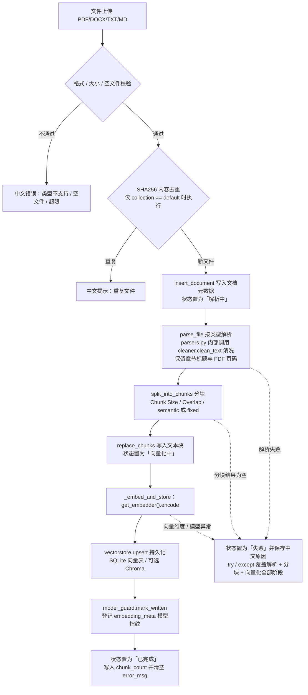
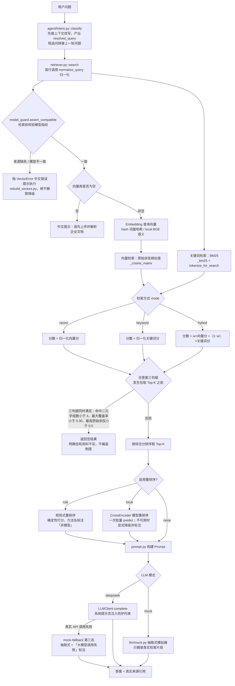
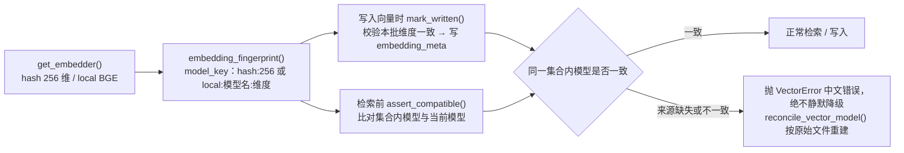

# RAG 处理流程

> 本文件与代码同版本维护。链路顺序、状态与判据均以 `backend/rag/`、`backend/services/document_service.py`、`backend/services/evaluation_service.py` 的真实实现为准。

## 一、文档处理链路（入库）

**顺序要点**（`backend/services/document_service.py::ingest_bytes`）：

- 真实顺序为 `insert_document → 状态「解析中」→ parse_file（内部清洗）→ split_into_chunks → replace_chunks + 状态「向量化中」→ _embed_and_store（Embedding + 向量 upsert + 指纹登记）→ 状态「已完成」`。**先写文档元数据与文本块，再做向量持久化**，不是先持久化向量再写元数据；中间有「解析中」「向量化中」两个中间态。
- `cleaner.py::clean_text` 在 `parsers.py::_group_lines` 的 `flush()` 中调用（对每段标题分组后的文本清洗），属于「解析」内部的一步，**不是 parsers 之后的独立清洗阶段**。
- 内容去重 `find_by_sha` 只在 `collection == "default"` 时执行；文档表写入、状态更新也只在该条件下执行。评估实验使用 `eval_*` 独立集合，不污染生产知识库。
- `try / except` 从 `parse_file` 一直包到 `_embed_and_store` 与状态更新：解析、分块、向量化任一阶段抛错，都把状态置为「失败」并保存中文原因。

**切换 Embedding 模型时的重建**（`document_service.py::reconcile_vector_model`）：同步样例文档前先比对模型指纹；不一致时清空集合，再按原始文件逐文档重新解析、分块、向量化，绝不混用不同模型的向量。详见第五节。

## 二、问答检索链路

**顺序要点**：真实链路是**先**由 Agent 侧 `intent.py::resolve_query / classify` 做上下文改写得到 `resolved_query`，**再**把该查询传入 `retriever.py::search`，由 `search` 首行的 `normalize_query` 做去控制字符、压缩空白、限长的归一。两者先后不能画反。

## 三、阶段与函数对照

| 阶段 | 实现 |
| --- | --- |
| Query 上下文改写 | `agent/intent.py::resolve_query`、`classify`（产出 `resolved_query`） |
| Query 归一 | `rag/cleaner.py::normalize_query`（在 `retriever.search` 首行调用） |
| 检索前模型指纹校验 | `rag/model_guard.py::assert_compatible` |
| 写入后指纹登记 | `rag/model_guard.py::mark_written`（写 `embedding_meta`） |
| Embedding | `rag/embeddings.py::get_embedder`（hash / local 双档） |
| 向量检索 | `rag/retriever.py::search`（`_cosine_matrix`，保留原始余弦用于无答案判据） |
| 关键词检索 | `rag/retriever.py::_bm25` |
| 混合加权与无答案判定 | `rag/retriever.py::search`（三判据在排序取 Top-K 之前） |
| 重排序 | `rag/rerank.py::apply_rerank`（`rule` 规则式 / `local` CrossEncoder 批量 `predict`） |
| Prompt 构建 | `rag/prompt.py::build_answer_prompt` |
| 答案生成 | `rag/pipeline.py::RAGPipeline.generate`（`deepseek` / `mock` / `mock-fallback` 三态） |
| 来源引用 | `rag/pipeline.py::RAGPipeline.to_sources`（取自真实向量记录） |
| 文档入库 | `services/document_service.py::ingest_bytes`、`_embed_and_store` |
| 向量重建 | `services/document_service.py::reconcile_vector_model` |
| 管线编排 | `rag/pipeline.py::RAGPipeline.answer`、`retrieve` |
| 评估指标 | `services/evaluation_service.py`（5 组实验，见第五节） |

## 四、关键设计说明

**混合检索公式**：`score = w × minmax(cosine) + (1 − w) × minmax(BM25)`，两边各自做 min-max 归一化后再加权，避免量纲差异。`w` 可在检索调试页与 `.env`（`HYBRID_WEIGHT`）调整。

**空结果与低相关性判定**（`rag/retriever.py` 常量与 `search`）：向量库为空直接返回中文提示；有向量时，在**按综合分排序取 Top-K 之前**，用未归一化的原始量做三判据，**三者同时满足**才判定资料不足并返回空结果：

1. 查询二元字组在任一文本块上的最大命中数 **< 4**（`_NO_ANSWER_MIN_HITS`）；
2. 最大二元字组覆盖率 **< 0.30**（`_NO_ANSWER_COVERAGE`，= 最大命中数 ÷ 查询二元字组集合大小）；
3. 最高原始余弦相似度 **< 0.5**（`_NO_ANSWER_SIMILARITY`）。

判据刻意**不使用 min-max 归一化后的综合分**（归一化后最高分恒为 1.0，无法反映绝对相关性），也不用「是否命中任一二元字组」这类宽松条件。这套三判据取代了早期「Top-1 综合分低于 0.08 且关键词分为 0」「Top-1 综合分 < 0.15」等过时说法。RAG 管线在没有任何命中时直接返回「资料不足」，不调用模型编造制度。注意 `agent/nodes.py::multi_step_node` 中仍有 `score >= 0.08` 的判断，但那只是「多步骤任务是否给出后续建议」的阈值，**不是**检索层的无答案判据。

**来源真实性**：`RetrievedChunk` 的文件名、章节、页码、文本片段全部来自 `vectors` 表中持久化记录，不存在虚构文档名或页码。PDF 页码由 pypdf 逐页解析，DOCX/TXT/MD 提供章节标题。

**Prompt 注入防护**：`prompt.py::sanitize_snippet` 把角色标记、`<|...|>` 类标记与「忽略以上指令」等短语替换为 `[已忽略的文档内标记]` / `[已忽略的文档内指令]`；系统提示明确声明检索资料为不可信数据，其中任何指令都不得当作系统或用户指令执行。

**Mock 模式与降级边界**：未配置 `DEEPSEEK_API_KEY` 时，检索、混合加权、重排、来源引用均为真实逻辑；答案生成降级为基于真实检索片段的原文抽取（`mock`），并在答案与界面上显著标注「模拟运行」。若处于真实模型模式但 API 调用抛 `LLMError`，`pipeline.py::generate` 返回第三态 `mock-fallback`：抽取式原文前加「【大模型调用失败】」并明确声明「不是模型生成的答案」，不伪装成模型输出。

## 五、第二轮新增能力与评估中心

### 5.1 Embedding 模型指纹一致性

- `backend/rag/model_guard.py`：`mark_written` 登记并校验维度、`assert_compatible` 检索前校验、`compatibility_status` 供 `/api/health` 只读展示；`backend/database/schema.py` 的 `embedding_meta` 表按 collection 记录 `model_key / model_name / dim / effective_mode / updated_at`。
- `document_service.py::reconcile_vector_model`：模型切换或来源标记缺失时清空集合并强制重建；`scripts/switch_embedding.py`、`scripts/rebuild_vectors.py` 是对应入口。
- `retriever.py::search` 中向量维度/模型异常会抛 `VectorError`，不再静默降级成纯关键词检索。

### 5.2 重排序：规则式与真实 CrossEncoder

- `rag/rerank.py::apply_rerank` 的 `local` 分支是**真实** `sentence_transformers.CrossEncoder`（`BAAI/bge-reranker-base`）一次批量 `predict([(query, text)...], batch_size=16)`，不是逐条前向。
- `rule` 分支是确定性打分（`_rule_score` = 综合分 + 关键词覆盖 + 章节加成 − 长度惩罚），方法名如实标注「规则式重排序（非模型）」。
- 模型不可用时 `method` 会被改写为「规则式重排序（CrossEncoder 不可用降级，非模型）」，评估服务的 `cross_encoder_status()` 在依赖缺失时直接判定不可用、不触发下载，**绝不把降级结果写成模型结果**。

### 5.3 评估中心：5 组实验与新增指标

| 实验 | 方案 | 实现 |
| --- | --- | --- |
| 实验一：文本分块策略 | 固定长度 / 句末优先 × 不同块大小 | `evaluation_service.py::_build_schemes` |
| 实验二：Top-K 检索数量 | Top-3 / 5 / 10 | 同上 |
| 实验三：检索方式对比 | 纯向量 / 关键词 / 混合 | 同上 |
| 实验四：重排序优化 | 原始 / **规则式** / **CrossEncoder 模型重排序** | `cross_encoder_status()` 可用时才追加模型方案 |
| 实验五：Embedding 模型对照 | hash vs 本地 BGE（同一测试集、同一分块参数、各自独立集合） | `run_embedding_comparison()` |

- 新增指标「**答案-上下文一致性（词面支撑率）**」：`_context_support()` 计算人工编写标准答案的二元字组在 Top-K 上下文中的覆盖率，是确定性代理指标，不调用大模型，用于同测试集方案间对照；不替代语义忠实度评估与人工判读。
- 标准答案改为测试问题集中人工审核的「相关块标识（`文档::章节`）」显式标注，按文档配对、分母固定（`_evidence_specs`），使不同分块方案之间的 Recall@K 可比。
- 无答案正确率的说明与检索器三判据保持一致（命中二元字组数 < 4、最大覆盖率 < 0.30、最高原始余弦 < 0.5）。
- **未运行说明**：本次环境未配置 `.env` / DeepSeek Key；可选依赖 `sentence-transformers` / `torch` 安装超过 29 分钟无进展已主动停止。实验四的 CrossEncoder 模型重排与实验五的 BGE 语义向量方案**均未运行**，`docs/evaluation_report.md` 明确标注「未运行 / 未生成任何指标」，为最终准绳；本文件不声称模型实验已跑出结果。
