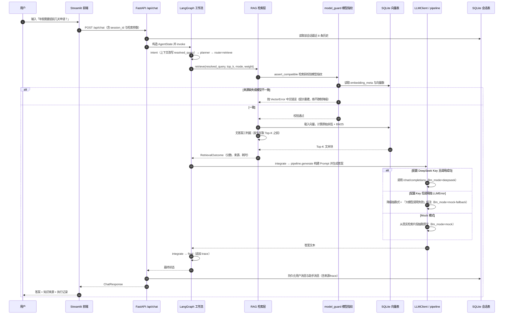
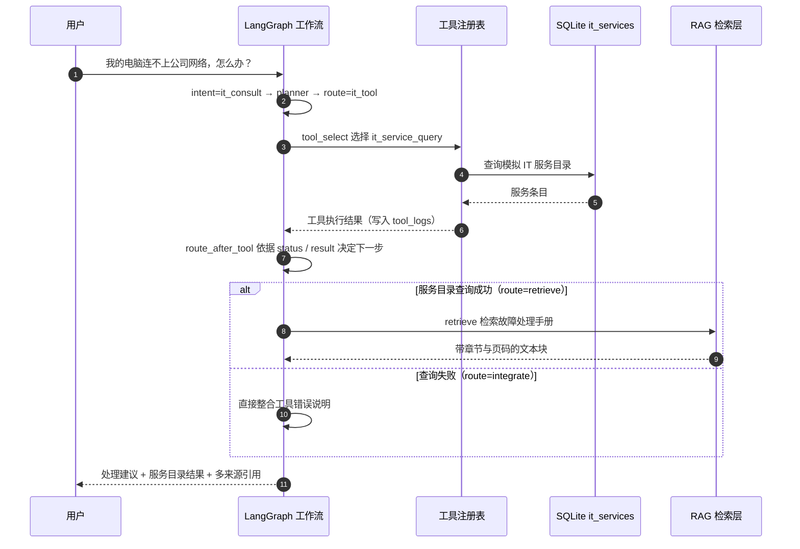
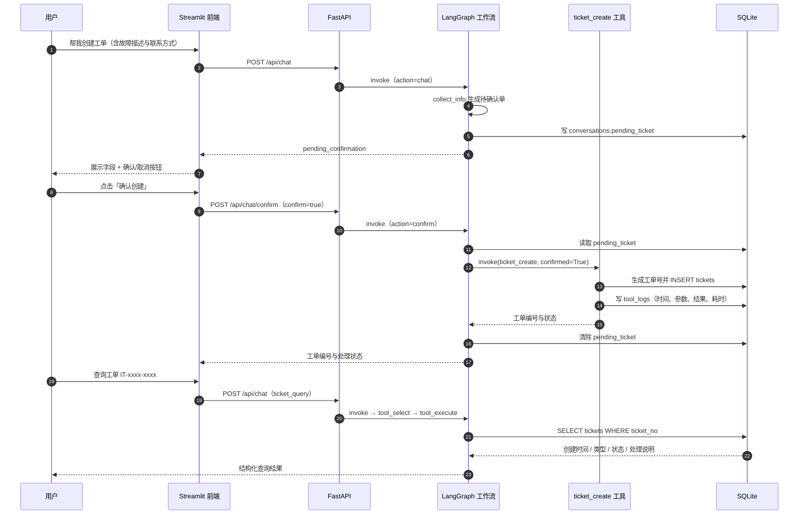
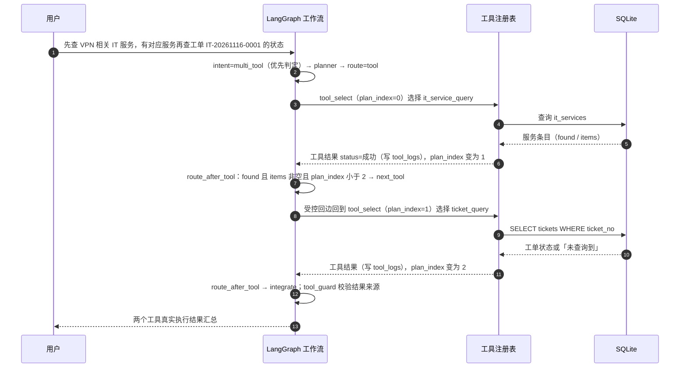
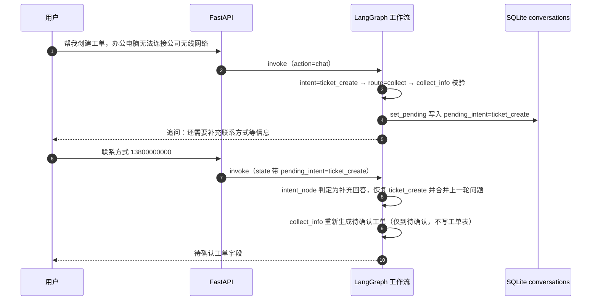
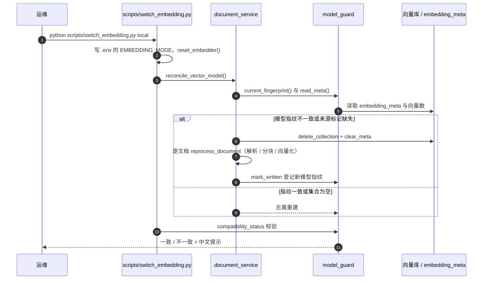

# 用户请求与工具调用时序图

> 时序与 `backend/agent/graph.py`、`planner.py`、`nodes.py`、`rag/retriever.py`、`rag/model_guard.py`、`rag/pipeline.py` 一致。

## 一、企业知识问答（场景 A / B / F）

## 二、IT 故障咨询（场景 C）

## 三、创建工单与查询状态（场景 D）

## 四、第二轮新增时序

### 4.1 多工具连续执行（`multi_tool` + `next_tool` 受控回边）

### 4.2 追问补答恢复（`pending_intent`）

### 4.3 切换 Embedding 模型与向量库重建

## 五、说明

- 所有工具调用都经过 `tools/registry.py::invoke`：Pydantic 参数校验 → 真实 Python 函数 → 结果写入 `tool_logs` → 返回给 Agent 整合。
- 工具逻辑与模型解耦：新增工具只需注册一个 `ToolSpec`，Agent 通过工具注册表元数据选择，不依赖模型内置工具绑定。
- 检索前 `model_guard.assert_compatible` 校验 `embedding_meta` 指纹，模型不一致或来源缺失时抛中文 `VectorError`，不静默降级成关键词检索。
- `pipeline.py::generate` 的答案为三态：`deepseek`（真实模型）、`mock`（本地抽取式）、`mock-fallback`（真实 API 失败后的抽取式并带标注），返回值如实写入 `llm_mode`。
- `agent/planner.py::route_after_tool` 依据前一步工具结果（`status`、`result` 的 `found / items`、`plan_index`）决定 `retrieve / next_tool / integrate`；`integrate_node` 整合前由 `agent/tool_guard.py::sanitize_tool_results` 校验工具结果来源，丢弃不合法条目并留痕。
- 时序图中的每个步骤都在代码中有对应函数与持久化记录，不存在「由模型生成一段看似执行成功文字」的伪调用。
- 模型相关方案（BGE 语义向量、CrossEncoder 模型重排）在本次环境中**均未运行**（可选依赖安装超过 29 分钟无进展已主动停止），详见 `docs/evaluation_report.md` 的「未运行说明」；本文件只描述已实现的链路。
